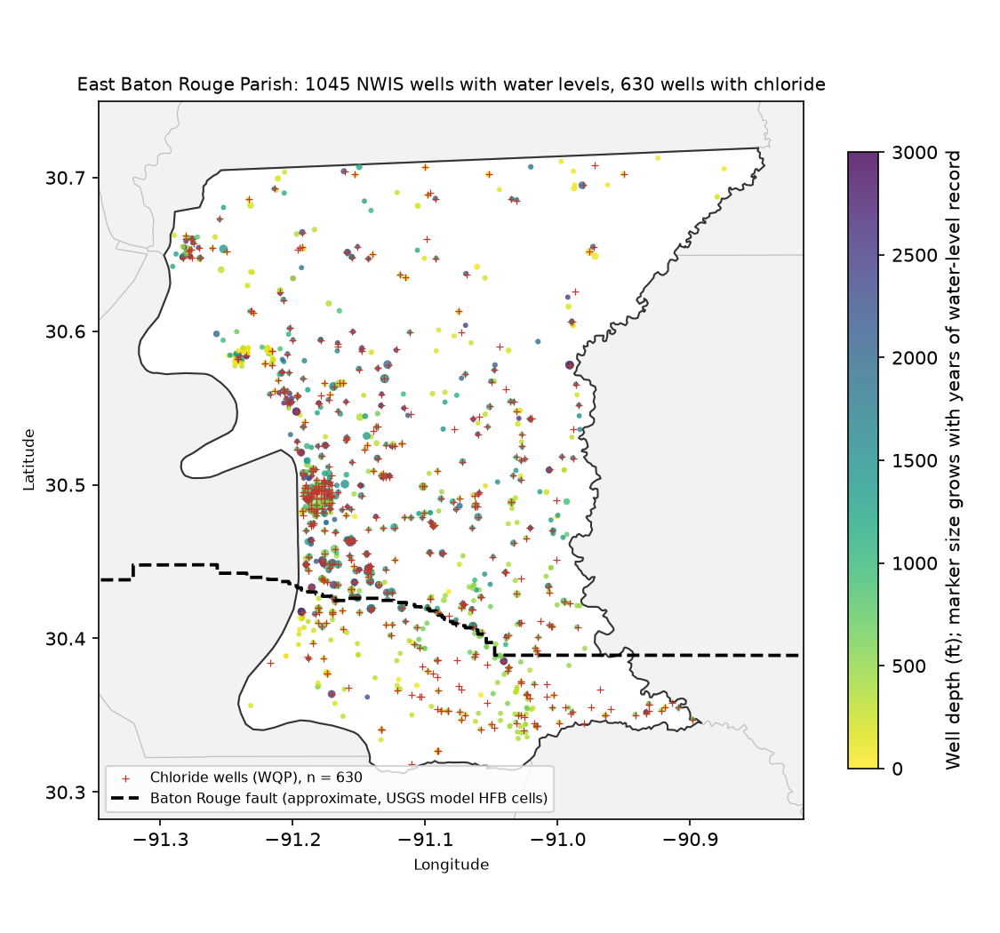
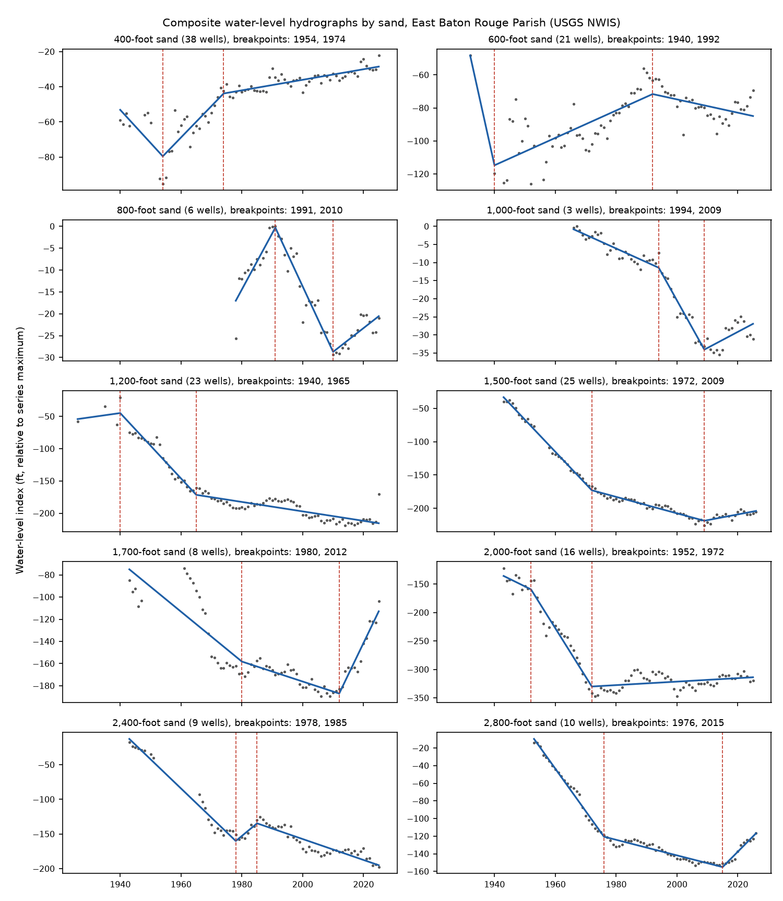
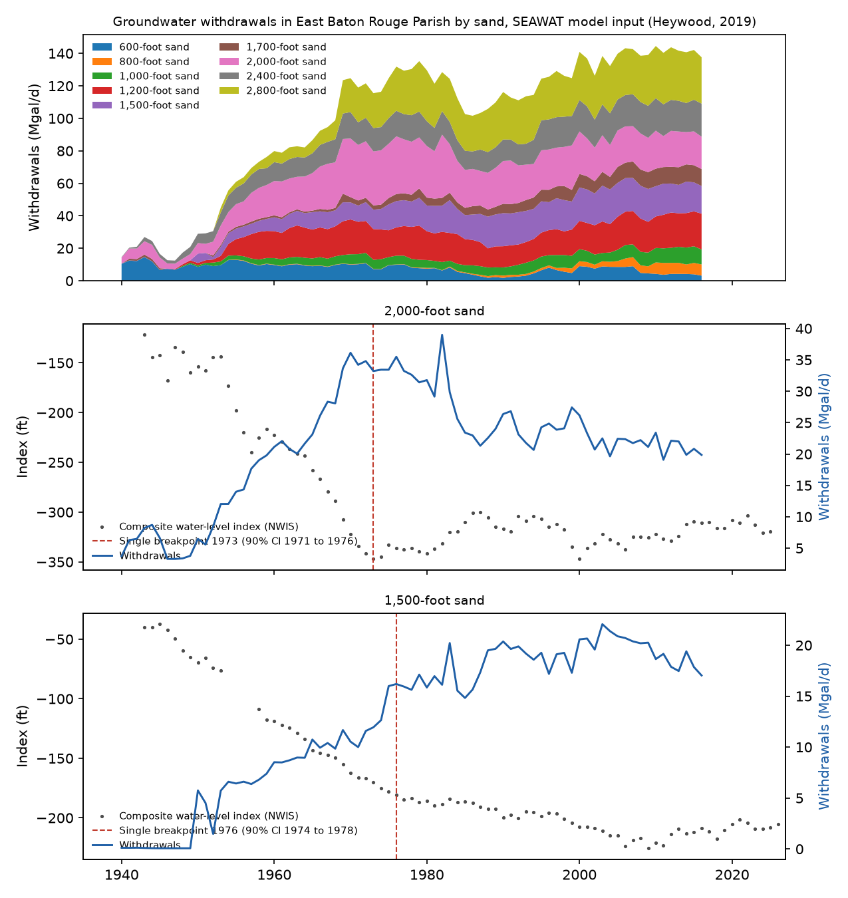
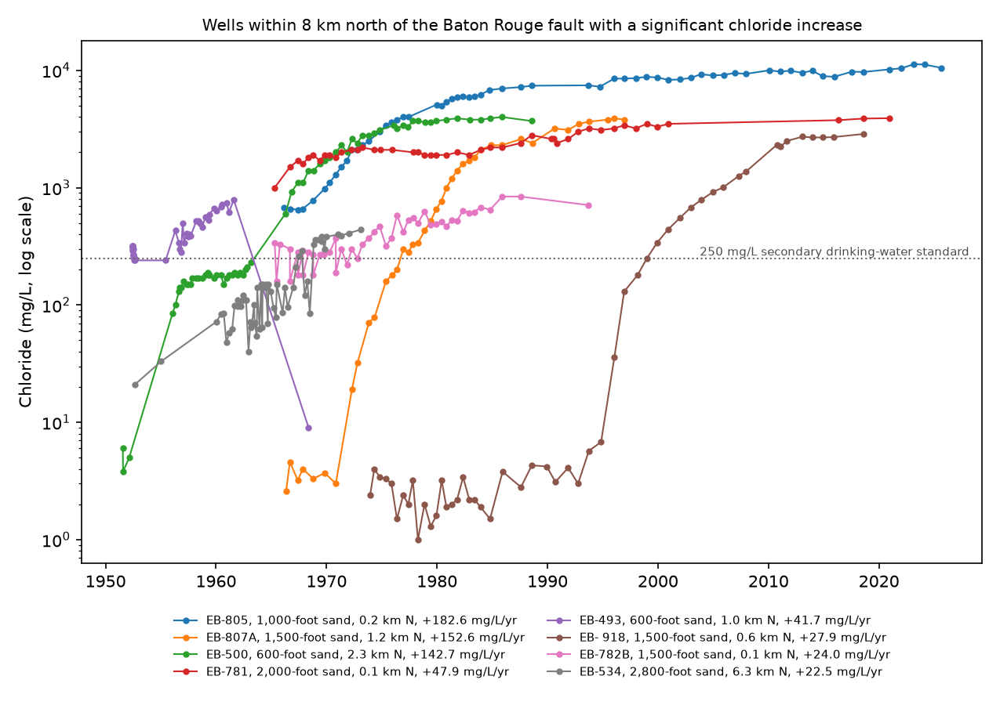
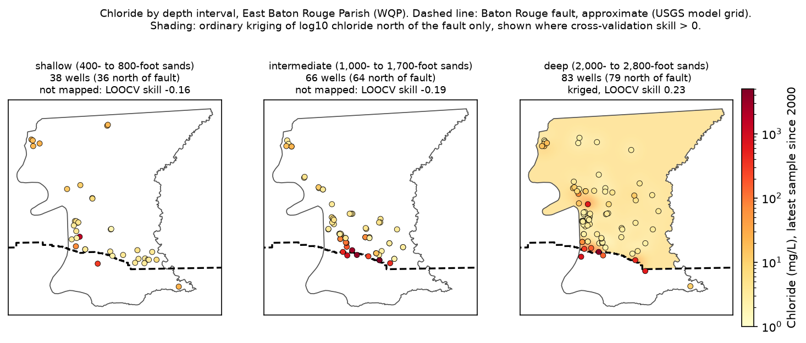
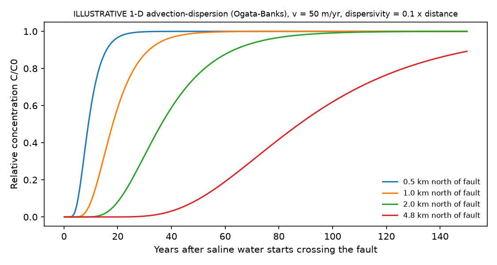

# Baton Rouge Aquifer System: Water-Level Trends and Saltwater Encroachment Across the Baton Rouge Fault

**Author:** Anamika Dristi, Ph.D.

This project looks at the freshwater sands of the Southern Hills aquifer system under East Baton Rouge Parish, Louisiana. It covers two linked problems: long-term water-level decline in the named sands (the "400-foot" to "2,800-foot" sands), and saltwater (chloride) moving north across the Baton Rouge fault. Groundwater levels come from 1,045 USGS NWIS wells (5,444 well-years, 1905 to 2026), and chloride comes from 4,290 well-date samples at 630 wells (1939 to 2025, Water Quality Portal). A fault trace and 1940 to 2016 withdrawals by sand are taken from a public USGS model archive. In the deep sands the decline was steepest before the 1970s: the "2,000-foot" sand fell about 7.3 ft per year until a breakpoint in 1973 (90% interval 1971 to 1976), and has risen slowly since then. The "1,500-foot", "2,400-foot" and "2,800-foot" sands broke between 1971 and 1979, but they kept falling at a slower rate afterwards. Of the 67 wells within 8 km north of the fault that have a long chloride record, 29 show a significant chloride increase. At one "1,000-foot" sand well near the fault, chloride is now above 10,000 mg/L.

This is an independent analysis of public data. It is separate from my LSU dissertation datasets and uses none of them.

## Why it matters

- **Drinking water supply.** The Baton Rouge area depends on these sands for public supply and industry. Chloride above the 250 mg/L secondary drinking-water standard makes water unsuitable without treatment or blending. Knowing which sands are recovering and which are still being drawn down helps decide where wells can be added and where withdrawals should be cut.
- **Regulatory context.** The Capital Area Groundwater Conservation Commission (CAGWCC) was created by the Louisiana Legislature in 1974 (Acts 1974, No. 678; R.S. 38:3071 to 3084). Under current law it covers Ascension, East Baton Rouge, East Feliciana, Pointe Coupee, West Baton Rouge and West Feliciana Parishes. Several of the USGS reports cited below were prepared in cooperation with the commission. The questions here (is a sand recovering after withdrawals changed, and how fast is the saltwater front moving toward production wells) are the questions the commission uses to set withdrawal limits.
- **Job areas.** The workflow is the kind of work done by environmental scientists at groundwater districts, state agencies (LDEQ, LDNR, TWDB, TCEQ), USGS water science centers and consulting firms. It covers public data APIs, trend statistics, change-point regression, geostatistics with cross-validation, GIS outputs, and a clear statement of uncertainty.

## Data sources

All data are public and were retrieved without accounts or API keys on 2026-10-23.

| Dataset | Provider and link | IDs and filters | Records used |
|---|---|---|---|
| Groundwater site metadata (aquifer code, well depth, land-surface altitude) | USGS NWIS site service, https://waterservices.usgs.gov/nwis/site/ | `countyCd=22033`, `siteType=GW`, `siteOutput=expanded` | 1,407 wells in East Baton Rouge Parish |
| Discrete groundwater levels | USGS Water Data OGC API, collection `field-measurements`, https://api.waterdata.usgs.gov/ogcapi/v0/collections/field-measurements | parameter 62610 (water-level altitude, NGVD29); bounding box around the parish, filtered to parish wells | 43,190 measurements after screening |
| Daily groundwater levels from recorders | USGS Water Data OGC API, collection `daily` | parameter 72019, statistic 00003 | 29,514 daily values at 7 wells |
| Chloride and specific conductance | Water Quality Portal, https://www.waterqualitydata.us (legacy profile for the full record, WQX 3.0 profile for 2023 onward) | `countycode=US:22:033`, `siteType=Well`, characteristics "Chloride" and "Specific conductance" | 4,290 chloride and 3,380 specific conductance well-dates |
| SEAWAT model archive: grid shapefile, horizontal-flow-barrier (fault) cells, well package | Heywood, C.E., 2019, USGS data release, https://doi.org/10.5066/P96YE03Q (ScienceBase item 631405c6d34e36012efa31db) | `georef.zip`, `ancillary.zip` (`hfb.tpl`), `model.zip` (`SEAWAT-scen1/scenario1.wel`, `1500.dis`) | 169 fault cell pairs; 77 annual stress periods (1940 to 2016) |
| Parish boundary | U.S. Census Bureau 2023 cartographic boundary counties, https://www2.census.gov/geo/tiger/GENZ2023/shp/cb_2023_us_county_500k.zip | GEOID 22033 | 1 polygon |

Notes on sources:

- The legacy NWIS groundwater-level web service (`waterservices.usgs.gov/nwis/gwlevels`) was retired in fall 2025 and now redirects. The new Water Data API was used instead.
- The legacy NWIS water-use pages that served county withdrawal tables now redirect to a general USGS page, so no county water-use table could be downloaded. Withdrawals by sand were taken from the Well Package of the USGS SEAWAT model (Heywood and others, 2019), which compiles reported withdrawals for 1940 to 2016. These are model input values, not an official water-use table.
- No standalone digital line for the Baton Rouge fault was found. The USGS Quaternary Fault and Fold Database shows this area only as the broad "Gulf-margin normal faults, Louisiana and Arkansas" polygon (fault 1022). The fault line used here is the set of model-cell edges where the USGS model places its horizontal flow barrier. It is a model-grid approximation (cells are about 500 ft wide near Baton Rouge), and it is labelled approximate everywhere. The Denham Springs-Scotlandville fault to the north is not in this model and is not mapped.

### USGS reports used for context

- Lovelace, J.K., 2007, Chloride concentrations in ground water in East and West Baton Rouge Parishes, Louisiana, 2004-05: USGS Scientific Investigations Report 2007-5069, https://doi.org/10.3133/sir20075069.
- Heywood, C.E., and Griffith, J.M., 2013, Simulation of groundwater flow in the "1,500-foot" sand and "2,000-foot" sand and movement of saltwater in the "2,000-foot" sand of the Baton Rouge area, Louisiana: USGS Open-File Report 2013-1153, https://pubs.usgs.gov/of/2013/1153/.
- Heywood, C.E., Griffith, J.M., and Lovelace, J.K., 2014, Simulation of groundwater flow in the "1,500-foot" sand and "2,000-foot" sand, with scenarios to mitigate saltwater migration in the "2,000-foot" sand of the Baton Rouge area, Louisiana: USGS Scientific Investigations Report 2013-5227, https://doi.org/10.3133/sir20135227.
- Heywood, C.E., Lindaman, M.A., and Lovelace, J.K., 2019, Simulation of groundwater flow and chloride transport in the "1,500-foot" sand, "2,400-foot" sand, and "2,800-foot" sand of the Baton Rouge area, Louisiana: USGS Scientific Investigations Report 2019-5102, https://doi.org/10.3133/sir20195102.
- Lindaman, M.A., 2024, Chloride concentrations in groundwater from the western part of the Southern Hills regional aquifer system, Louisiana, 2021-22: USGS Scientific Investigations Report 2024-5057, https://doi.org/10.3133/sir20245057.

These reports describe the setting used here: aquifers south of the fault generally hold saltwater, withdrawals north of the fault have created gradients that pull it north, and background chloride north of the fault is generally below 10 mg/L (SIR 2007-5069).

## Methods

1. **Wells and sands** (`02_prepare_wells_levels.py`). Each NWIS well gets a sand from its NWIS local aquifer code (for example `12220BR` = "2,000-foot sand of Baton Rouge area"; names come from the Water Data API `aquifer-codes` collection). Field measurements flagged as pumping, no measurement or foreign substance are dropped. Daily recorder depths are converted to altitude using the NWIS land-surface altitude. Each well gets one value per year: the mean of the daily values if a recorder was running, or otherwise the mean of the field visits.
2. **Per-well trends** (`05_water_level_trends.py`). Mann-Kendall test with the Hamed and Rao correction for serial correlation, plus Sen slope (ft per year) on annual values. Applied to wells with at least 10 years of data spanning at least 15 years. Run for the full record and for 2000 onward.
3. **Composite hydrograph per sand.** A two-way fixed-effects fit, level[well, year] = a[well] + b[year], on all wells in a sand with at least 5 years of data. The year effects b form a hydrograph that is not biased when wells join or leave the network. Years with only one measured well are dropped.
4. **Piecewise regression.** Continuous segmented linear fits with 0, 1 or 2 breakpoints (grid search, at least 6 years per segment), compared by BIC. A 90% interval for the single-breakpoint year comes from a moving-block bootstrap of residuals (5-year blocks, 500 replicates). Breakpoints are then compared with withdrawals by sand from the USGS model Well Package (`04_fault_and_withdrawals.py`). Rates are given in ft3/d and converted to Mgal/d.
5. **Chloride** (`03_prepare_chloride.py`, `06_chloride_trends_maps.py`).
   - Routine samples only. Results on the same well and date are averaged. Field specific conductance is preferred over laboratory values.
   - Each well gets a signed distance to the approximate fault (positive north).
   - Trends: wells with at least 8 samples over at least 10 years are tested with Mann-Kendall and Sen slope (mg/L per year).
   - Maps: the latest sample since 2000 at each well, in three depth intervals by aquifer code: shallow ("400-foot" to "800-foot" sands), intermediate ("1,000-foot" to "1,700-foot") and deep ("2,000-foot" to "2,800-foot").
   - Ordinary kriging of log10 chloride (PyKrige; the exponential or spherical variogram is chosen by leave-one-out error). It is applied only to wells north of the fault and only inside the parish north of the fault, because the fault is a hydraulic barrier.
   - A surface is shown only if leave-one-out cross-validation beats the plain mean (skill = 1 - MSE_kriging / MSE_mean > 0).
6. **Illustrative intrusion calculations** (`07_intrusion_illustration.py`), for the "2,000-foot" sand only. All of these are labelled illustrative:
   - two-end-member mixing fractions;
   - a check that chloride is linear in specific conductance;
   - the hydraulic gradient north of the fault from a plane fitted to 2015 to 2025 heads;
   - Darcy front speed with assumed K and porosity ranges;
   - an apparent front speed from the first year chloride passed 50 mg/L at wells at different distances;
   - Ogata-Banks one-dimensional advection-dispersion breakthrough curves.
7. **GIS outputs** (`08_overview_figures_gis.py`). Shapefiles, a KML file and GeoTIFFs. See "How to run".

## Key findings

All numbers below come from the run of this code on 2026-10-23 and are saved in `outputs/tables/`.

**Water levels**

| Sand | Wells in composite | Years | Single breakpoint (90% CI) | Slope before (ft/yr) | Slope after (ft/yr) | Wells rising / falling since 2000 (significant) |
|---|---|---|---|---|---|---|
| "400-foot" | 38 | 1940 to 2025 | 1953 (1948 to 2015) | -0.76 | +0.62 | 2 / 0 of 8 |
| "600-foot" | 21 | 1932 to 2025 | 1940 (1940 to 1967) | -6.96 | +0.39 | 0 / 1 of 6 |
| "1,200-foot" | 23 | 1926 to 2025 | 1970 (1966 to 1974) | -3.87 | -0.66 | 1 / 2 of 5 |
| "1,500-foot" | 25 | 1943 to 2026 | 1976 (1974 to 1978) | -4.61 | -0.62 | 2 / 0 of 6 |
| "2,000-foot" | 16 | 1943 to 2025 | 1973 (1971 to 1976) | -7.26 | +0.27 | 5 / 0 of 8 |
| "2,400-foot" | 9 | 1943 to 2025 | 1971 (1966 to 1978) | -4.30 | -1.02 | 0 / 2 of 6 |
| "2,800-foot" | 10 | 1953 to 2026 | 1979 (1976 to 1983) | -4.68 | -0.24 | 1 / 0 of 5 |

- BIC favoured two breakpoints for every sand. The single-breakpoint fit is shown above because it is easier to compare across sands. The two-breakpoint fits are in `piecewise_regression_by_sand.csv`. Examples:
  - "2,000-foot" sand: breaks in 1952 and 1972, with slopes of -2.6, -8.5 and +0.3 ft per year;
  - "2,800-foot" sand: a second change in 2015, after which levels rise about 3.5 ft per year;
  - "1,700-foot" sand: a rise of about 5.7 ft per year after 2012, based on only 8 wells.
- Over the full record, most wells in the "1,200-foot" (11 of 14), "1,500-foot" (12 of 16), "2,400-foot" (5 of 7) and "2,800-foot" (6 of 9) sands have significant declines.
- Since 2000, the "2,000-foot" sand stands out: 5 of 8 wells are rising significantly, with a median Sen slope of +1.85 ft per year.
- Withdrawals from the "2,000-foot" sand in the parish (model input) rose to 36 Mgal/d by 1970, stayed at 31 to 39 Mgal/d until 1982, then dropped to 23 Mgal/d by 1985 and to 20 Mgal/d by 2016.
  - The water-level decline stopped when withdrawals levelled off in the early 1970s.
  - Levels rose in the early 1980s after the drop in withdrawals.
  - In the "1,500-foot" sand, withdrawals kept growing (16 Mgal/d in 1976, peak 22 Mgal/d in 2003), and levels kept falling, more slowly.
- Total modelled withdrawals in the parish were 14.6 Mgal/d in 1940, 124.7 in 1975, a peak of 144.6 in 2010, and 137.6 in 2016.

**Chloride**

- Wells with at least 8 samples over at least 10 years:

  | Location | Wells | Significant increase | Significant decrease |
  |---|---|---|---|
  | Within 8 km north of the fault | 67 | 29 | 4 |
  | Within 8 km south of the fault | 23 | 12 | 4 |

- The largest increases north of the fault are close to it:

  | Well | Sand | Distance north of fault | Change | Sen slope (mg/L/yr) |
  |---|---|---|---|---|
  | EB-805 | "1,000-foot" | 0.2 km | 680 mg/L (1966) to 10,500 mg/L (2025) | +183 |
  | EB-807A | "1,500-foot" | 1.2 km | 2.6 to 3,800 mg/L (1966 to 1996) | +153 |
  | EB-918 | "1,500-foot" | 0.6 km | 2.4 to 2,870 mg/L (1973 to 2018) | +28 |
  | EB-781 | "2,000-foot" | 0.05 km | 1,000 to 3,910 mg/L (1965 to 2020) | +48 |
  | EB-1150 | "2,000-foot" | 2.1 km | 11 mg/L (1991) to 29.5 mg/L (2025), peak 311 mg/L | +9.1 |

- Latest sample since 2000, north of the fault:

  | Depth interval | Wells | Median chloride (mg/L) | Wells above 250 mg/L |
  |---|---|---|---|
  | Shallow | 36 | 4.3 | 1 |
  | Intermediate | 64 | 4.4 | 6 |
  | Deep | 79 | 3.4 | 4 |

  The median is near the background level, and high values cluster within about 2 km of the fault.
- Kriging had skill only in the deep interval:
  - deep: LOOCV RMSE 0.557 log10 units against 0.636 for the plain mean, skill 0.23;
  - shallow (skill -0.16) and intermediate (skill -0.19): interpolation did worse than the mean, so these intervals are shown as points only.
  - With data this sparse and plumes this narrow, a pooled kriging surface mostly smooths plumes away.

**Illustrative intrusion calculation ("2,000-foot" sand; not a model result)**

- Specific conductance and chloride are almost perfectly linear (n = 3,321 samples, R2 = 0.99; chloride is about 0.36 times specific conductance minus 155). This fits mixing of fresh water with one saline water type.
- End members:
  - fresh: 4.0 mg/L, the median of 11 wells more than 8 km north;
  - saline: either 661 mg/L (median of 70 samples at 4 wells south of the fault) or 3,910 mg/L (the highest value in the sand).
  - Well EB-781 at the fault is above the south-side median, which shows that the saline end member is poorly constrained.
  - Using the higher end member, 3 of the 22 wells within 8 km north of the fault sampled since 2000 have more than 1% saline water.
- The plane fit to 8 wells gives a 2015 to 2025 head gradient north of the fault of about 0.0029.
  - With assumed K of 30 to 200 ft/d and effective porosity of 0.35 to 0.20, the advective speed is about 28 to 330 m per year, so a front would take about 15 to 170 years to travel 3 miles.
  - Two wells give an apparent front speed of about 50 m per year. EB-630, 1.6 km north, passed 50 mg/L in 1991; EB-1150, 2.1 km north, passed it in 2000. This is within the Darcy range.
- `fig06` shows Ogata-Banks curves at 50 m per year with dispersivity set to 10% of distance. At 4.8 km (3 miles), relative concentration reaches 0.5 after about 88 years.

## Figures



*Figure 1. NWIS wells with water levels (colour = depth), WQP chloride wells, and the approximate Baton Rouge fault.*



*Figure 2. Composite water-level index per sand with the BIC-selected piecewise fit.*



*Figure 3. Modelled withdrawals by sand in East Baton Rouge Parish (top), and withdrawals against composite levels for the "2,000-foot" and "1,500-foot" sands.*



*Figure 4. Chloride at wells within 8 km north of the fault with the largest significant increases.*



*Figure 5. Latest chloride since 2000 by depth interval. Kriging is shown only where cross-validation skill is positive.*



*Figure 6. Illustrative one-dimensional breakthrough curves (not a calibrated model).*

## Limitations

- **Sparse data.** Only 1,045 of 1,407 parish wells have any water level, and many have only one or two years. Composite series rest on 3 to 38 wells per sand. The "1,000-foot" (3 wells), "800-foot" (6) and "1,700-foot" (8) sands are thin, and their breakpoints have wide intervals. Before about 1950, most years have only a handful of wells.
- **Uneven chloride sampling.** Sampling is concentrated in the 1960s to 1980s and in 2021-22. Of the 94 wells with enough data for a trend test, 44 had their last sample before 2000. Only 4 wells in the "2,000-foot" sand south of the fault have samples since 1990.
- **Approximate fault.** The fault is a model-grid approximation, so wells within about 0.5 km of it may be on the wrong side. The signed distances should be read as approximate.
- **Withdrawals are model input.** They are not an official water-use table. The model Well Package has no pumping in the "400-foot" sand and little in the "600-foot" sand, so withdrawals from the shallow sands are probably understated, and the shallow-sand breakpoints cannot be tied to withdrawals.
- **Pooled sands.** Pooling several sands into one depth interval for kriging mixes aquifers that are hydraulically separate. The surfaces are screening maps, not plume outlines.
- **Correlation, not cause.** Breakpoints and withdrawal changes are compared by eye and by timing only. Other factors, such as pumping outside the parish and changes in the network, also affect levels.
- **Illustrative calculations.** The hydraulic conductivity and porosity values are assumed ranges, not values taken from the cited reports. The apparent front speed rests on two wells. The calculations ignore density effects, vertical leakage, faults as partial barriers, and the real geometry of flow paths. The USGS SEAWAT models cited above are the right tools for prediction.
- **WQP coverage.** Recent USGS results come from the Water Quality Portal WQX 3.0 profile. The legacy profile returned USGS results only to March 2023 for this query, so the WQX 3.0 rows (2023 to 2025) were merged with it by well and date.

## How to run

```bash
python -m venv .venv
source .venv/bin/activate
pip install -r requirements.txt
bash scripts/run_all.sh          # about 10 to 20 minutes, mostly downloads
```

Raw downloads go to `data/raw/`, which is git-ignored. Set `BRAQ_RAW_DIR=/path` to keep them somewhere else. R is not used.

**ArcGIS Pro, QGIS and Google Earth.** These tools were not run for this project. Everything was done in Python with open-source libraries. The outputs open directly in these tools:

1. In ArcGIS Pro or QGIS, add these files from `outputs/gis/`:
   - `wells_water_level.shp`
   - `chloride_latest_since2000.shp`
   - `baton_rouge_fault_approx.shp`
   - `kriged_chloride_mgL_deep_north_of_fault.tif` (NAD83 / UTM zone 15N)
2. Symbolize `chloride_latest_since2000` by `chloride_m` with a logarithmic or manual-break classification (for example 10, 50, 250, 1,000 mg/L), and filter by `interval`.
3. Optional: in ArcGIS Pro, run Geostatistical Wizard (Kriging) or Empirical Bayesian Kriging on the deep-interval points north of the fault, using log-transformed chloride, and compare its cross-validation to `outputs/tables/kriging_cross_validation.csv`.
4. In Google Earth Pro, open `baton_rouge_fault_approx.kml`.

Check these steps yourself before describing any ArcGIS or Google Earth work as done.

## Repository structure

```
baton-rouge-aquifer-saltwater-intrusion/
  README.md  LICENSE  requirements.txt  .gitignore
  scripts/
    common.py                    paths, aquifer codes, model layer to sand map
    01_download_data.py          all downloads (NWIS, Water Data API, WQP, ScienceBase, Census)
    02_prepare_wells_levels.py   wells and annual water levels
    03_prepare_chloride.py       chloride and specific conductance, distance to fault
    04_fault_and_withdrawals.py  fault line and withdrawals by sand from the USGS model archive
    05_water_level_trends.py     Mann-Kendall, Sen slope, composite hydrographs, piecewise regression
    06_chloride_trends_maps.py   chloride trends, maps, kriging with cross-validation
    07_intrusion_illustration.py illustrative mixing, Darcy and Ogata-Banks calculations
    08_overview_figures_gis.py   overview and withdrawal figures, shapefile and KML export
    run_all.sh
  data/
    processed/   cleaned well, level, chloride, withdrawal and composite tables (CSV)
    gis/         baton_rouge_fault_approx.geojson
  outputs/
    figures/     fig01 to fig06 (PNG)
    tables/      trend, breakpoint, chloride, kriging and illustration results
    gis/         shapefiles, KML, GeoTIFFs
```

## Citation and author

Anamika Dristi, Ph.D. 2026. *Baton Rouge aquifer system: water-level trends and saltwater encroachment across the Baton Rouge fault.* Independent analysis of public USGS, Water Quality Portal and Census data. GitHub: anamikadristi/baton-rouge-aquifer-saltwater-intrusion.

Related published work by the author, on surface-water carbon and nutrients in Louisiana (cited for context only; not used in this analysis):

- Dristi, A., and Xu, Y.J., 2023. *Water* 15(14):2621.
- Dristi, A., and Xu, Y.J., 2025. *Water* 17(17):2589.
- Dristi, A., et al., 2025. *Estuarine, Coastal and Shelf Science* 324:109465.

Contact: anamikadristi@gmail.com
